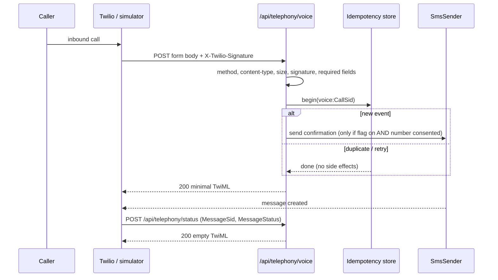

# Telephony Webhooks Lab (simulator-first)

Branch: `feature/telephony-webhooks`

## 1. Event sequence

## 2. Environment variables
| Var | Purpose | Default |
|---|---|---|
| `TWILIO_AUTH_TOKEN` | signing key (simulator: any local string) | required, fails closed |
| `TELEPHONY_PUBLIC_BASE_URL` | exact public base URL used for signature checks | required |
| `SMS_SENDING_ENABLED` | must be exactly `true` to send | off |
| `SMS_CONSENTED_NUMBERS` | comma list of E.164 numbers that consented | empty |
| `TWILIO_ACCOUNT_SID`, `TWILIO_FROM_NUMBER` | real sending only | unset |

Put these in `.env.local` (gitignored) and Vercel env settings, never in commands or screenshots.
## 3. Simulator steps (no paid access needed)
1. `npm i`, then `npm run test:telephony` runs the fixture tests (no server needed).
2. Add to `.env.local`: `TWILIO_AUTH_TOKEN=local-sim-token` and `TELEPHONY_PUBLIC_BASE_URL=http://localhost:3000`
3. Terminal 1: `npm run dev` (wait for "Ready"; restart it after editing `.env.local`).
4. Terminal 2: export the same two variables, then run:
   `npm run simulate:telephony -- voice-inbound --replay`
   Expect `HTTP 200` twice, but only one `received` and one `duplicate` log line, and no SMS.
5. `npm run simulate:telephony -- voice-inbound --tamper` should print `HTTP 403`.
6. `npm run simulate:telephony -- status-delivered` exercises the status callback.

The in-memory store remembers a CallSid until the server restarts, so restart `npm run dev` before repeating step 4.

## 4. Threat model (one test per threat)
| Threat | Mitigation | Test |
|---|---|---|
| Forged request | HMAC-SHA1 over exact public URL + params, constant-time compare | invalid signature -> 403 |
| Missing signature | rejected before any processing | missing header -> 403 |
| Callback URL confusion | verify against configured URL, never `req.url` or Host | wrong-URL signature -> 403 |
| Body tampering | raw body parsed once, signed params | tampered body -> 403 |
| Replay / provider retry | idempotency key = event ID (+ status) | duplicate -> one SMS |
| Failure then retry | claim released on error, 500 so provider retries | retry test |
| Unwanted SMS | flag defaults off + consent allowlist | flag-off and no-consent tests |
| Oversized or odd requests | 4 KB cap, POST only, form content type | 405 / 415 / 413 test |
| PII in logs | closed log schema, last 4 digits only | log-scan test |
| Information leak in errors | generic JSON errors | covered by status-code tests |
| Rate limiting | not implemented (documented gap) | none |

## 5. Known limitations
- In-memory idempotency does not survive a restart and is not shared across serverless instances. A production fix is a Supabase table with a UNIQUE event key and `INSERT ... ON CONFLICT DO NOTHING`.
- The body size limit is checked after the body is buffered. A streaming limit would be stricter.
- A valid signature proves the request came from the provider, not that it is fresh. Idempotency handles replays of the same event.
- No rate limiting is implemented. It should be added at the edge or in the hosting layer.
- Evidence comes from the simulator only. No Twilio number was used, so there are no provider logs to reconcile against the application logs.

## 6. AI collaboration log
Prompt used with both tools (secrets and private data excluded; only `handler.ts` and `signature.ts` shared):

> Threat-model this webhook handler. Focus on signature verification, replay, idempotency, logging, PII minimization, rate limits, and safe error responses. Return one test per threat.

| Field | ChatGPT | Gemini |
|---|---|---|
| Useful output | | |
| Rejected output (and why) | | |
| How verified | | |
| Commit | | |

## 7. Verification checklist
- [x] Invalid signatures are rejected (403)
- [x] Duplicate events create no duplicate SMS
- [x] Logs contain no full phone numbers, recordings, or tokens
- [x] Simulator path works without paid service
- [ ] Provider log vs application log reconciled (not applicable: simulator only)

## 8. Evidence
- Test run: 14 of 14 passing (`npm run test:telephony`)
- Simulator: replay gives 200 and 200 with one `received` and one `duplicate` log line; tamper gives 403; status callback gives 200
- Commit: `74fde0c`